<p align="center">
  <a href="https://recallmem.dev">
    <picture>
      <source media="(prefers-color-scheme: dark)" srcset=".github/assets/hero-dark.svg">
      <source media="(prefers-color-scheme: light)" srcset=".github/assets/hero-light.svg">
      
    </picture>
  </a>
</p>

<p align="center">
  <a href="https://recallmem.dev"><b>Website</b></a> ·
  <a href="https://recallmem.dev/docs"><b>Docs</b></a> ·
  <a href="https://app.recallmem.dev/keys"><b>Get an API key</b></a> ·
  <a href="https://github.com/recallmem/recall"><b>Main repository</b></a>
</p>

<p align="center">
  <a href="LICENSE"></a>
  <a href="plugins/recall-memory"></a>
  <a href="https://registry.modelcontextprotocol.io/v0.1/servers?search=dev.recallmem/memory"></a>
</p>

**Your agent forgets you when the session ends. These plugins fix that.** They give Claude Code,
Codex, OpenClaw and Hermes long-term memory through [Recall](https://recallmem.dev). Your messages
and your agent's replies go to Recall, which works out in the background what is true about you,
keeps it as dated facts with their sources, and retires facts that stop being true. The next time
you talk, your agent already knows. Nothing to code: install the plugin for your agent, give it an
API key, and keep working.

<p align="center"></p>

## What it does

<picture>
  <source media="(prefers-color-scheme: dark)" srcset=".github/assets/how-it-works-dark.svg">
  <source media="(prefers-color-scheme: light)" srcset=".github/assets/how-it-works-light.svg">
  
</picture>

1. **Recall.** Your peer card and the facts Recall has learned about you are added to the agent's
   context: when a session starts in Claude Code and Codex, before each turn in OpenClaw and Hermes.
2. **Record.** Each message you send and the agent's final reply are stored in a Recall session,
   so Recall keeps learning from your work. The agent is a non-observed peer: facts are learned
   about you, not from its own statements.
3. **Learn.** Recall builds your memory in the background, and your agent can look things up and
   correct memory with Recall's tools.

They fail quietly: requests time out after a few seconds, a failure makes them skip Recall for a
minute, and anything that could not be sent waits and goes out in order once Recall answers again.

<p align="center"></p>

## Install

Create an API key at **[app.recallmem.dev/keys](https://app.recallmem.dev/keys)**; new accounts
get $5 of free credit. Running Recall yourself? Point the plugin at your own server's URL instead
([self-hosting](https://recallmem.dev/docs#self-host)). Each folder's README covers the settings,
how to check that it works, and troubleshooting.

### Claude Code

Needs Claude Code with plugin support and Node 18+ on your `PATH`.

```text
/plugin marketplace add recallmem/recall-plugin
/plugin install recall-memory@recall
```

When you enable the plugin, Claude Code asks for your Recall API key and keeps it in your system's
secure credential store. Restart Claude Code (or run `/reload-plugins`), then run
`/recall-memory:status` to see whether the server answers and accepts your key.
It also adds Recall's MCP tools. [README](plugins/recall-memory/README.md) ·
[docs](https://recallmem.dev/docs#claude-code)

### Codex

Needs Codex CLI with hooks and Node 18+ on your `PATH`.

```bash
codex plugin marketplace add recallmem/recall-plugin
codex plugin add recall-memory@recall
```

Then start Codex and run **`/hooks`**: Codex skips new hooks until you trust them, so trust the
three Recall hooks. The key comes from `RECALL_API_KEY` or `~/.recall/config.json`. Without the
plugin system, an installer sets up the same hooks and tools; pick one route, since installing
both handles every turn twice. [README](integrations/codex/README.md) ·
[docs](https://recallmem.dev/docs#codex)

### OpenClaw

Needs OpenClaw 2026.9.9 or later. Install from a checkout, then let the plugin read the
conversation, which OpenClaw only allows a third-party plugin once you grant it:

```bash
git clone https://github.com/recallmem/recall-plugin
openclaw plugins install ./recall-plugin/integrations/openclaw --force --accept-capabilities
openclaw config set plugins.entries.recall-memory.hooks '{"allowConversationAccess":true}' --strict-json --merge
```

Set the URL, workspace and your peer name in the plugin's config, and the API key in the
Gateway's environment or `~/.recall/config.json`; then restart the Gateway. It runs next to
OpenClaw's own memory and adds four `recall_*` tools. [README](integrations/openclaw/README.md) ·
[docs](https://recallmem.dev/docs#openclaw)

### Hermes Agent

A memory provider next to Hermes' own `MEMORY.md` and `USER.md` memory:

```bash
git clone https://github.com/recallmem/recall-plugin
mkdir -p ~/.hermes/plugins
cp -r recall-plugin/integrations/hermes/recall ~/.hermes/plugins/recall
hermes memory setup        # pick "recall" and enter the URL, API key, workspace and your peer id
```

`hermes memory status` shows whether it is active. [README](integrations/hermes/README.md) ·
[docs](https://recallmem.dev/docs#hermes)

### Any agent with skills

An [Agent Skill](https://agentskills.io) that teaches an agent when and how to recall and record,
through Recall's MCP tools or a helper script. Copy it to where your agent loads skills from
(`~/.claude/skills/`, `~/.agents/skills/` or `~/.hermes/skills/`):

```bash
git clone https://github.com/recallmem/recall-plugin
mkdir -p ~/.agents/skills && cp -r recall-plugin/integrations/agent-skill/recall-memory ~/.agents/skills/
```

[README](integrations/agent-skill/README.md)

Any other MCP client can connect to Recall's MCP server at `https://api.recallmem.dev/mcp`
([docs](https://recallmem.dev/docs#mcp)).

<p align="center"></p>

## What gets sent

For each turn, your message and the agent's final reply, each cut to 24,000 characters, go to the
Recall server you configured, which analyses them with its language model. Tool calls, tool output
and file contents are not sent. What the agent asks Recall's tools goes there too, and Hermes also
sends the facts its built-in memory saves about you. The Agent Skill sends nothing on its own: the
agent decides when to use it.

Do not point a plugin at a server you do not trust. For work you do not want remembered, set
`RECALL_RECORD=false` to stop recording, or in Claude Code and Codex `RECALL_ENABLED=false` to turn
the hooks off. The Claude Code plugin reads no files from your machine and takes the API key only
from its own protected setting. Each README has the details for its agent.

<p align="center"></p>

## Licence

Everything in this repository is open source under the [MIT licence](LICENSE). The Recall server
the plugins talk to lives in [recallmem/recall](https://github.com/recallmem/recall): it is
source-available under the Functional Source License (FSL-1.1-ALv2), and you can self-host it.

Issues and pull requests are welcome here. For your account or billing, write to
support@recallmem.dev.

<p align="center"></p>

<p align="center">
  <a href="https://recallmem.dev">Website</a> ·
  <a href="https://recallmem.dev/docs">Docs</a> ·
  <a href="https://recallmem.dev/privacy">Privacy</a> ·
  <a href="https://recallmem.dev/terms">Terms</a> ·
  <a href="https://recallmem.dev/support">Support</a>
  <br>
  <sub>Recall is made by Smidt Beheer in the Netherlands.</sub>
</p>
